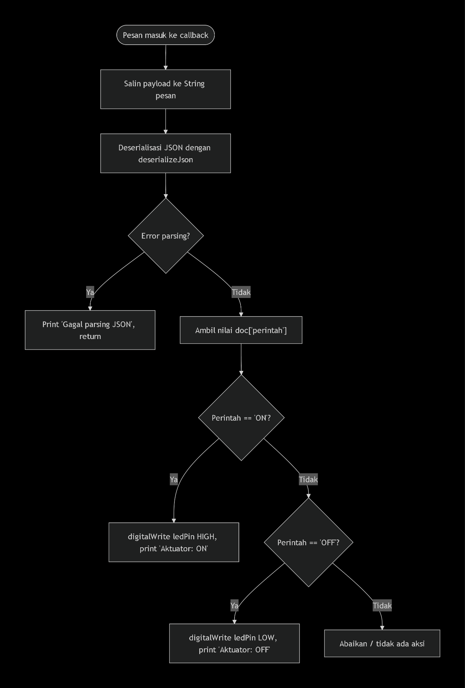

# Pertemuan 4

## 4.5.4 Pertanyaan Percobaan 4A: Subscribe dan Deserialisasi

1. Gambarkan diagram alur (flowchart) proses penerimaan dan pemrosesan pesan pada fungsi callback di atas!



2. Apa yang akan terjadi apabila pesan yang dipublikasikan bukan merupakan format JSON yang valid?

> Fungsi deserializeJson() akan mengembalikan error. Program menampilkan pesan "Gagal parsing JSON" dan langsung return, sehingga tidak ada perintah yang dieksekusi. LED tetap pada kondisi terakhir.

3. Jelaskan mengapa fungsi client.subscribe() dipanggil di dalam fungsi hubungkanMQTT(), bukan di dalam setup()!

> Karena subscribe hanya bisa dilakukan setelah koneksi ke broker berhasil. Jika diletakkan di setup(), sedangkan koneksi belum tentu berhasil, subscribe akan gagal. Selain itu, jika koneksi terputus dan reconnect, hubungkanMQTT() akan dipanggil lagi dan subscribe ulang secara otomatis.

4. Modifikasi program agar data JSON yang diterima juga memuat nilai intensitas (misalnya {"perintah": "ON", "intensitas": 200}) yang digunakan untuk mengatur kecerahan LED menggunakan PWM (analogWrite/ledcWrite), dan berikan penjelasan di setiap baris kode yang ditambahkan dalam bentuk README.md!

 ```c++
 #include <ESP8266WiFi.h>
 #include <PubSubClient.h>
 #include <ArduinoJson.h>

 const char* ssid = "Findaaa";
 const char* password = "Findaimutt";
 const char* mqttServer = "broker.hivemq.com";
 const int mqttPort = 1883;
 const char* topicPerintah = "unsoed/tk245004/kelompok3/perintah";
 const int ledPin = D4; // D4 = GPIO4, sesuai kabel di rangkaian

 WiFiClient espClient;
 PubSubClient client(espClient);

 void callback(char* topic, byte* payload, unsigned int length) {
   String pesan;
   for (unsigned int i = 0; i < length; i++) {
     pesan += (char)payload[i];
   }
   Serial.print("Pesan diterima [");
   Serial.print(topic);
   Serial.print("]: ");
   Serial.println(pesan);

   JsonDocument doc;
   DeserializationError error = deserializeJson(doc, pesan);
   if (error) {
     Serial.print("Gagal parsing JSON: ");
     Serial.println(error.c_str());
     return;
   }

   const char* perintah = doc["perintah"] | "";

   // ===== BARIS TAMBAHAN: ambil nilai intensitas dari JSON =====
   // Default 255 (kecerahan penuh) jika field intensitas tidak ada
   int intensitas = doc["intensitas"] | 255;
   // ===========================================================

   if (strcmp(perintah, "ON") == 0) {
     // ===== BARIS TAMBAHAN: atur kecerahan LED via PWM =====
     // analogWrite menerima nilai 0-255 (duty cycle PWM)
     // Nilai intensitas dari JSON digunakan langsung sebagai duty cycle
     analogWrite(ledPin, intensitas);
     // =======================================================
     Serial.print("Aktuator: ON, Intensitas: ");
     Serial.println(intensitas);
   } else if (strcmp(perintah, "OFF") == 0) {
     // ===== BARIS TAMBAHAN: matikan LED (duty cycle 0) =====
     analogWrite(ledPin, 0);
     // ======================================================
     Serial.println("Aktuator: OFF");
   } else {
     Serial.println("Perintah tidak dikenal");
   }
 }

 void hubungkanWiFi() {
   WiFi.mode(WIFI_STA);
   WiFi.begin(ssid, password);
   Serial.print("Menghubungkan ke WiFi");
   while (WiFi.status() != WL_CONNECTED) {
     delay(500);
     Serial.print(".");
   }
   Serial.println("\nWiFi berhasil terhubung!");
   Serial.print("IP: ");
   Serial.println(WiFi.localIP());
 }

 void hubungkanMQTT() {
   while (!client.connected()) {
     Serial.print("Menghubungkan ke broker MQTT...");
     String clientId = "ESP8266Client-" + String(random(0xffff), HEX);
     if (client.connect(clientId.c_str())) {
       Serial.println("berhasil terhubung!");
       client.subscribe(topicPerintah);
       Serial.print("Subscribe ke topic: ");
       Serial.println(topicPerintah);
     } else {
       Serial.print("gagal, rc=");
       Serial.print(client.state());
       Serial.println(" coba lagi dalam 2 detik");
       delay(2000);
     }
   }
 }

 void setup() {
   Serial.begin(115200);
   pinMode(ledPin, OUTPUT);
   // ===== BARIS TAMBAHAN: pastikan LED mati di awal =====
   analogWrite(ledPin, 0);
   // =====================================================
   hubungkanWiFi();
   client.setServer(mqttServer, mqttPort);
   client.setCallback(callback);
 }

 void loop() {
   if (WiFi.status() != WL_CONNECTED) {
     hubungkanWiFi();
   }
   if (!client.connected()) {
     hubungkanMQTT();
   }
   client.loop();
 }
 ```

> Baris pertama yang ditambahkan adalah `int intensitas = doc["intensitas"] | 255;` yang berfungsi untuk mengambil nilai intensitas dari JSON dengan default 255 (kecerahan penuh) jika field intensitas tidak ada pada payload. Baris kedua adalah `analogWrite(ledPin, intensitas);` yang mengatur duty cycle PWM sesuai nilai intensitas dari JSON (rentang 0-255). Baris ketiga adalah `analogWrite(ledPin, 0);` pada kondisi OFF untuk mematikan LED secara penuh. Baris keempat adalah `analogWrite(ledPin, 0);` di setup() untuk memastikan LED dalam kondisi mati saat program baru dimulai. Dengan penambahan ini, payload JSON `{"perintah": "ON", "intensitas": 200}` akan menghasilkan LED dengan kecerahan sekitar 78% (200/255), sehingga kecerahan LED dapat dikontrol secara dinamis dari broker MQTT.

## 4.6.4 Pertanyaan Percobaan 4B: Pertukaran Data Dua Arah

1. Mengapa penggunaan delay() yang lama sebaiknya dihindari pada program yang menggabungkan proses publish dan subscribe secara bersamaan?

> delay() bersifat blocking—seluruh program berhenti, termasuk client.loop(). Akibatnya, pesan MQTT yang masuk tidak diproses, koneksi bisa terputus, dan sistem tidak responsif.

2. Jelaskan cara kerja mekanisme non-blocking menggunakan fungsi millis() pada program di atas!

> Program menyimpan waktu terakhir publish di waktuTerakhirPublish. Setiap loop, dicek apakah millis() - waktuTerakhirPublish > intervalPublish. Jika ya, publish dilakukan dan waktu diperbarui. Jika tidak, loop tetap berjalan dan client.loop() tetap dipanggil.

3. Apa yang akan terjadi apabila fungsi client.loop() jarang dipanggil (misalnya hanya sekali setiap 10 detik)?

> Pesan yang masuk akan tertunda diproses atau bahkan hilang. Koneksi ke broker bisa terputus karena keepalive tidak terjaga. Sistem menjadi tidak responsif terhadap perintah.

4. Modifikasi program agar menambahkan satu topic perintah baru untuk mengendalikan aktuator kedua (misalnya buzzer), dengan fungsi callback yang dapat membedakan topic mana yang menerima pesan, dan berikan penjelasan di setiap baris kode yang ditambahkan dalam bentuk README.md!

 ```c++
 #include <ESP8266WiFi.h>
 #include <PubSubClient.h>
 #include <ArduinoJson.h>

 const char* ssid = "OPPO A31";
 const char* password = "12345678";
 const char* mqttServer = "broker.hivemq.com";
 const int mqttPort = 1883;

 // ===== BARIS TAMBAHAN: dua topic terpisah untuk LED dan buzzer =====
 const char* topicPerintahLed = "unsoed/tk245004/kelompok3/perintah/led";
 const char* topicPerintahBuzzer = "unsoed/tk245004/kelompok3/perintah/buzzer";
 // ===================================================================

 const int ledPin = D2;

 // ===== BARIS TAMBAHAN: definisi pin buzzer =====
 const int buzzerPin = D1;
 // ===============================================

 WiFiClient espClient;
 PubSubClient client(espClient);

 void callback(char* topic, byte* payload, unsigned int length) {
   String pesan;
   for (unsigned int i = 0; i < length; i++) pesan += (char)payload[i];

   JsonDocument doc;
   if (deserializeJson(doc, pesan)) return;

   // ===== BARIS TAMBAHAN: bedakan topic mana yang menerima pesan =====
   if (strcmp(topic, topicPerintahLed) == 0) {
     const char* perintah = doc["perintah"];
     digitalWrite(ledPin, String(perintah) == "ON" ? HIGH : LOW);
     Serial.print("LED -> "); Serial.println(perintah);
   } else if (strcmp(topic, topicPerintahBuzzer) == 0) {
     const char* perintah = doc["perintah"];
     digitalWrite(buzzerPin, String(perintah) == "ON" ? HIGH : LOW);
     Serial.print("Buzzer -> "); Serial.println(perintah);
   }
   // ==================================================================
 }

 // ===== BARIS TAMBAHAN: fungsi hubungkanWiFi() =====
 void hubungkanWiFi() {
   WiFi.mode(WIFI_STA);
   WiFi.begin(ssid, password);
   Serial.print("Menghubungkan ke WiFi");
   while (WiFi.status() != WL_CONNECTED) {
     delay(500);
     Serial.print(".");
   }
   Serial.println("\nWiFi berhasil terhubung!");
   Serial.print("IP: ");
   Serial.println(WiFi.localIP());
 }
 // ===================================================

 void hubungkanMQTT() {
   while (!client.connected()) {
     String clientId = "ESP8266Client-" + String(random(0xffff), HEX);
     if (client.connect(clientId.c_str())) {
       // ===== BARIS TAMBAHAN: subscribe ke kedua topic =====
       client.subscribe(topicPerintahLed);
       client.subscribe(topicPerintahBuzzer);
       Serial.println("Subscribe ke topic LED dan Buzzer");
       // ====================================================
     } else {
       delay(2000);
     }
   }
 }

 void setup() {
   Serial.begin(115200);
   pinMode(ledPin, OUTPUT);
   // ===== BARIS TAMBAHAN: atur pin buzzer sebagai output =====
   pinMode(buzzerPin, OUTPUT);
   // ==========================================================
   hubungkanWiFi();
   client.setServer(mqttServer, mqttPort);
   client.setCallback(callback);
 }

 void loop() {
   if (!client.connected()) hubungkanMQTT();
   client.loop();
 }
 ```

> Baris-baris yang ditambahkan: (1) `const char* topicPerintahLed` dan `const char* topicPerintahBuzzer` mendefinisikan dua topic MQTT yang terpisah untuk mengendalikan LED dan buzzer secara independen. (2) `const int buzzerPin = D1` mendefinisikan pin digital D1 sebagai pin output buzzer. (3) Pada fungsi callback, `strcmp(topic, topicPerintahLed)` dan `strcmp(topic, topicPerintahBuzzer)` membedakan topic mana yang menerima pesan, sehingga pesan pada topic LED hanya mengontrol LED dan pesan pada topic buzzer hanya mengontrol buzzer. (4) `client.subscribe(topicPerintahLed)` dan `client.subscribe(topicPerintahBuzzer)` berlangganan ke kedua topic secara bersamaan. (5) `pinMode(buzzerPin, OUTPUT)` mengatur pin D1 sebagai output untuk buzzer. (6) Fungsi `hubungkanWiFi()` ditambahkan karena dipanggil di dalam setup() namun tidak ada pada kode asli. Dengan modifikasi ini, sistem dapat mengendalikan dua aktuator secara independen melalui dua topic MQTT yang berbeda.
