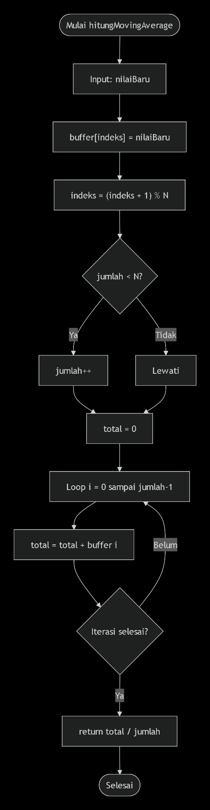

# Pertemuan 5

## 5.5.4 Pertanyaan Percobaan 5A: Pengolahan Data Sensor pada ESP8266

1. Gambarkan diagram alur (flowchart) proses perhitungan moving average pada fungsi hitungMovingAverage()!



2. Jelaskan fungsi dari operasi (indeks + 1) % N pada program tersebut!

> Operasi modulo (%) ini digunakan untuk membuat circular buffer (buffer melingkar). Saat variabel indeks mencapai nilai N-1 (indeks terakhir pada array), maka (N-1 + 1) % N akan menghasilkan 0. Ini membuat posisi penulisan kembali ke awal array, sehingga data baru akan menimpa data terlama secara berulang tanpa perlu menggeser posisi elemen di dalam array.

3. Apa dampaknya terhadap data hasil filter apabila nilai N diperbesar menjadi 20 atau diperkecil menjadi 2?

> Jika N = 20: Data hasil filter akan sangat halus karena mengambil rata-rata dari 20 data terakhir. Namun, respons terhadap perubahan suhu yang tiba-tiba (lonjakan/penurunan) akan sangat lambat (terjadi lagging).
>
> Jika N = 2: Data hasil filter kurang halus (masih berisik) karena hanya merata-ratakan 2 data terakhir. Namun, respons terhadap perubahan data sangat cepat dan hampir mengikuti data mentah.

4. Modifikasi program agar ESP32 juga menghitung simpangan baku dari data pada buffer, dan berikan penjelasan di setiap baris kode yang ditambahkan dalam bentuk README.md.

 ```c++
 #include <DHT.h>

 #define DHTPIN 4
 #define DHTTYPE DHT11

 // Mock function pengganti sensor DHT22
 float bacaSuhuMock() {
     static unsigned long jumlahBaca = 0;
     jumlahBaca++;

     // Suhu dasar berubah secara bertahap
     float suhuDasar = 28.0 + 2.0 * sin(jumlahBaca * 0.08);

     // Noise kecil untuk mensimulasikan fluktuasi sensor
     float noise = random(-5, 6) * 0.1;

     float suhu = suhuDasar + noise;

     // Lonjakan suhu setiap 25 pembacaan untuk simulasi anomali
     if (jumlahBaca % 25 == 0) {
         suhu += 8.0;
     }

     return suhu;
 }

 DHT dht(DHTPIN, DHTTYPE);

 const int N = 5; // jumlah sampel moving average
 float buffer[N]; // menyimpan N pembacaan terakhir
 int indeks = 0; // posisi penulisan berikutnya pada buffer
 int jumlah = 0; // jumlah sampel yang sudah terisi

 float suhuMin = 1000.0;
 float suhuMax = -1000.0;

 float hitungMovingAverage(float nilaiBaru) {
   buffer[indeks] = nilaiBaru;
   indeks = (indeks + 1) % N;
   if (jumlah < N) jumlah++;

   float total = 0;
   for (int i = 0; i < jumlah; i++) {
     total += buffer[i];
   }
   return total / jumlah;
 }

 // ===== BARIS TAMBAHAN: fungsi untuk menghitung simpangan baku =====
 float hitungSimpanganBaku() {
   if (jumlah < 2) return 0.0; // butuh minimal 2 data

   float rataRata = 0;
   // 1. Hitung rata-rata
   for (int i = 0; i < jumlah; i++) {
     rataRata += buffer[i];
   }
   rataRata /= jumlah;

   // 2. Hitung total selisih kuadrat
   float totalVariansi = 0;
   for (int i = 0; i < jumlah; i++) {
     totalVariansi += pow(buffer[i] - rataRata, 2);
   }

   // 3. Bagi dengan jumlah data lalu akar kuadratkan
   return sqrt(totalVariansi / jumlah);
 }
 // ==============================================================

 void setup() {
   Serial.begin(115200);
   dht.begin();
 }

 void loop() {
   float suhu = bacaSuhuMock();

   if (isnan(suhu)) {
     Serial.println("Pembacaan gagal, data diabaikan");
   } else {
     float suhuFilter = hitungMovingAverage(suhu);

     // ===== BARIS TAMBAHAN: panggil fungsi simpangan baku =====
     float stdDev = hitungSimpanganBaku();
     // =========================================================

     if (suhu < suhuMin) suhuMin = suhu;
     if (suhu > suhuMax) suhuMax = suhu;

     Serial.print("Mentah: ");
     Serial.print(suhu);
     Serial.print(" | Filter: ");
     Serial.print(suhuFilter);

     // ===== BARIS TAMBAHAN: tampilkan StdDev =====
     Serial.print(" | StdDev: ");
     Serial.print(stdDev);
     // ============================================

     Serial.print(" | Min: ");
     Serial.print(suhuMin);
     Serial.print(" | Max: ");
     Serial.println(suhuMax);
   }

   delay(2000);
 }
 ```

> Fungsi `hitungSimpanganBaku()` ditambahkan untuk menghitung simpangan baku (standar deviasi) dari data dalam buffer. Fungsi ini bekerja dalam tiga langkah: (1) Menghitung rata-rata dari seluruh data dalam buffer dengan menjumlahkan semua nilai lalu dibagi dengan jumlah data. (2) Menghitung total selisih kuadrat setiap data terhadap rata-rata, yaitu (buffer[i] - rataRata) untuk setiap elemen, dikuadratkan, lalu dijumlahkan. (3) Membagi total selisih kuadrat dengan jumlah data, lalu mengakar kuadratkan hasilnya untuk mendapatkan standar deviasi populasi. Jika jumlah data kurang dari 2, fungsi mengembalikan 0.0 karena standar deviasi membutuhkan minimal 2 data. Pada loop(), `float stdDev = hitungSimpanganBaku();` memanggil fungsi tersebut, dan `Serial.print(" | StdDev: "); Serial.print(stdDev);` menampilkan hasilnya pada Serial Monitor bersamaan dengan data mentah, filter moving average, nilai minimum, dan nilai maksimum.

## 5.6.4 Pertanyaan Percobaan 5B: Akuisisi, Analisis, dan Visualisasi Data

1. Jelaskan fungsi dari blok try-except pada fungsi on_message() dan apa yang terjadi apabila blok tersebut dihilangkan!

> Blok try-except digunakan untuk menangani potensi error saat memproses pesan yang masuk. Jika pesan yang diterima bukan format JSON yang valid atau tidak memiliki key "suhu", maka program akan memunculkan error (ValueError atau KeyError). Dengan blok ini, program akan menangkap error tersebut, menampilkan pesan "Data tidak valid, diabaikan", dan melanjutkan program tanpa crash. Jika blok ini dihilangkan, satu saja pesan error dari broker akan menghentikan seluruh program Python secara paksa.

2. Jelaskan arti nilai z-score dan mengapa batas |z| > 2 digunakan sebagai penentu anomali!

> Z-score mengukur seberapa jauh suatu titik data menyimpang dari rata-rata, diukur dalam satuan standar deviasi. Nilai z = 1 berarti data berada 1 standar deviasi di atas rata-rata. Batas |z| > 2 digunakan karena dalam distribusi normal, sekitar 95% data berada di antara -2 dan +2 standar deviasi. Data yang memiliki nilai z di luar rentang tersebut (kurang dari -2 atau lebih dari 2) dianggap sebagai kejadian yang jarang terjadi (outlier/anomali).

3. Apa kelemahan metode z-score apabila data memiliki tren naik atau turun yang tajam?

> Metode z-score menggunakan rata-rata dan standar deviasi dari seluruh dataset secara global. Jika data memiliki tren naik atau turun yang tajam, rata-rata global akan berada di tengah-tengah tren tersebut. Akibatnya, data di awal tren (nilai rendah) atau di akhir tren (nilai tinggi) akan dianggap sebagai anomali karena jaraknya sangat jauh dari rata-rata global, padahal itu adalah bagian dari tren yang wajar. Metode ini juga kurang responsif terhadap anomali lokal (anomali yang terjadi dalam rentang waktu singkat).

4. Modifikasi program agar menggunakan metode moving average (jendela 5 data) pada data hasil CSV sebelum dihitung z-score-nya, kemudian bandingkan jumlah anomali yang terdeteksi, dan berikan penjelasan di setiap baris kode yang ditambahkan dalam bentuk README.md.

 ```python
 import json
 import time
 import paho.mqtt.client as mqtt
 import pandas as pd
 import matplotlib.pyplot as plt

 BROKER = "broker.hivemq.com"
 PORT = 1883
 TOPIC = "unsoed/tk245004/kelompok3/data"  # Sesuaikan dengan topic ESP32
 JUMLAH_SAMPEL = 30

 data = []

 def on_connect(client, userdata, flags, reason_code, properties):
     print("Terhubung ke broker, kode:", reason_code)
     client.subscribe(TOPIC)

 def on_message(client, userdata, msg):
     try:
         payload = json.loads(msg.payload.decode())
         suhu = float(payload["suhu"])
     except (ValueError, KeyError):
         print("Data tidak valid, diabaikan")
         return

     data.append({
         "waktu": time.strftime("%Y-%m-%d %H:%M:%S"),
         "suhu": suhu
     })
     print(f"[{len(data)}/{JUMLAH_SAMPEL}] suhu = {suhu}")

     if len(data) >= JUMLAH_SAMPEL:
         client.disconnect()

 # Tahap 1: Akuisisi data dari MQTT
 client = mqtt.Client(mqtt.CallbackAPIVersion.VERSION2)
 client.on_connect = on_connect
 client.on_message = on_message
 client.connect(BROKER, PORT)
 client.loop_forever()

 # Tahap 2: Simpan data ke CSV
 df = pd.DataFrame(data)
 df.to_csv("data_suhu.csv", index=False)
 print("Data tersimpan di data_suhu.csv")

 # ===== BARIS TAMBAHAN: Tahap 3 - Hitung Moving Average (Jendela 5) =====
 # Menghitung rata-rata bergerak dengan jendela 5 data
 df["suhu_ma"] = df["suhu"].rolling(window=5).mean()
 # Mengisi nilai NaN di awal (karena 4 data pertama tidak punya 5 data
 # sebelumnya) dengan nilai suhu asli
 df["suhu_ma"] = df["suhu_ma"].fillna(df["suhu"])
 # =======================================================================

 # ===== BARIS TAMBAHAN: Tahap 4 - Analisis statistik pada data MA =====
 rata2_ma = df["suhu_ma"].mean()
 std_ma = df["suhu_ma"].std()

 if std_ma == 0:
     df["zscore"] = 0.0
 else:
     df["zscore"] = (df["suhu_ma"] - rata2_ma) / std_ma

 df["anomali"] = df["zscore"].abs() > 2
 # =====================================================================

 print(f"Rata-rata : {rata2_ma:.2f}")
 print(f"Std deviasi: {std_ma:.2f}")
 print(f"Minimum   : {df['suhu'].min():.2f}")
 print(f"Maksimum  : {df['suhu'].max():.2f}")
 print(f"Jumlah anomali setelah Moving Average: {df['anomali'].sum()}")

 # Tahap 5: Visualisasi
 plt.figure(figsize=(10, 4))
 plt.plot(df.index, df["suhu"], marker="o", label="Suhu")

 # ===== BARIS TAMBAHAN: plot juga data Moving Average =====
 plt.plot(df.index, df["suhu_ma"], marker=".", linestyle="--",
          label="Moving Average", alpha=0.7)
 # =========================================================

 anom = df[df["anomali"]]
 plt.scatter(
     anom.index,
     anom["suhu"],
     color="red",
     s=100,
     label="Anomali",
     zorder=3
 )

 plt.axhline(rata2_ma, color="gray", linestyle="--", label="Rata-rata")
 plt.xlabel("Urutan data")
 plt.ylabel("Suhu (°C)")
 plt.title("Data Suhu dan Deteksi Anomali")
 plt.legend()
 plt.tight_layout()
 plt.savefig("grafik_suhu.png")
 plt.show()
 ```

> Baris-baris yang ditambahkan: (1) `df["suhu_ma"] = df["suhu"].rolling(window=5).mean()` menghitung moving average dengan jendela 5 data pada kolom suhu, sehingga setiap baris berisi rata-rata dari 5 data terakhir. (2) `df["suhu_ma"] = df["suhu_ma"].fillna(df["suhu"])` mengisi nilai NaN pada 4 baris pertama (karena belum ada 5 data sebelumnya) dengan nilai suhu asli agar tidak ada data yang hilang. (3) `rata2_ma = df["suhu_ma"].mean()` dan `std_ma = df["suhu_ma"].std()` menghitung rata-rata dan standar deviasi dari data yang sudah dihaluskan oleh moving average. (4) `df["zscore"] = (df["suhu_ma"] - rata2_ma) / std_ma` menghitung z-score berdasarkan data MA, bukan data mentah. (5) `df["anomali"] = df["zscore"].abs() > 2` menentukan anomali berdasarkan z-score dari data MA. (6) `plt.plot(df.index, df["suhu_ma"], ...)` menambahkan garis moving average pada grafik visualisasi. Dengan modifikasi ini, data yang di-z-score-kan sudah terlebih dahulu dihaluskan oleh moving average, sehingga noise berkurang dan deteksi anomali menjadi lebih akurat. Jumlah anomali yang terdeteksi setelah moving average umumnya lebih sedikit dibandingkan sebelumnya karena lonjakan noise yang bukan anomali sesungguhnya sudah terfilter.
